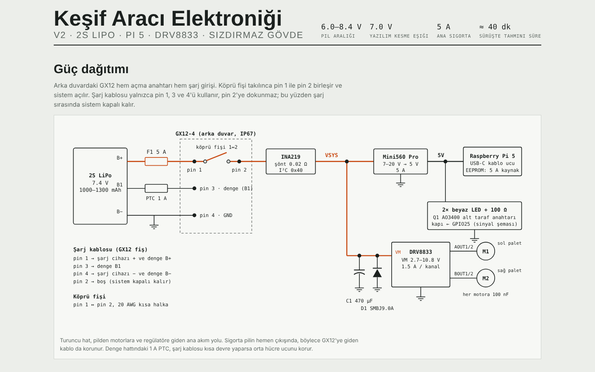

# Keşif Aracı — Sealed Tracked Recon Robot (Raspberry Pi 5)

A small, **fully sealed, tracked reconnaissance robot** built around a Raspberry Pi 5 and the Raspberry Pi AI Camera. The goal is a vehicle that can move in harsh places — sand, rock, caves, warehouses and ventilation ducts — and keep working even when it flips upside down.

> Status: design and prototyping. All mechanical parts are designed to be 3D-printed.

**▶ Electronics documentation (live):** <https://eneserdogans.github.io/demos/kesif-elektronik/>

## Design goals

- Fully enclosed body with no vents
- Tracks driven by two JGA25-370 gear motors
- Invertible design — drives the same way upside down
- Front LED lighting, front and rear bumpers, external antenna port
- Everything printable on a home 3D printer

## Electronics (v2)

| Part | Role |
|---|---|
| Raspberry Pi 5 | Main computer |
| Raspberry Pi AI Camera | On-board object detection |
| 2S LiPo (7.4 V, 1000–1300 mAh) | Battery |
| DRV8833 | Dual motor driver (left / right track) |
| Mini560 Pro | 7–20 V → 5 V / 5 A regulator for the Pi |
| INA219 | Battery voltage / current monitoring (I²C) |
| GX12-4 connector (IP67) | Power switch (bridge plug) and charging port on the rear wall |

Main numbers: 6.0–8.4 V battery range, 7.0 V software cut-off, 5 A main fuse, about 40 minutes of driving.

The full power and signal schematics, GPIO and GX12 pin tables, power budget, Pi 5 settings and first power-on steps are in [`docs/elektronik.html`](docs/elektronik.html) (Turkish).

## Repository

| Path | Content |
|---|---|
| `docs/elektronik.html` | Electronics documentation (open in a browser) |
| `screenshots/` | Images of the documentation |

## Roadmap

- [ ] Print and assemble the v2 chassis
- [ ] Motor control and camera streaming software
- [ ] A smaller version with TT gear motors and an ESP, driven from a phone
